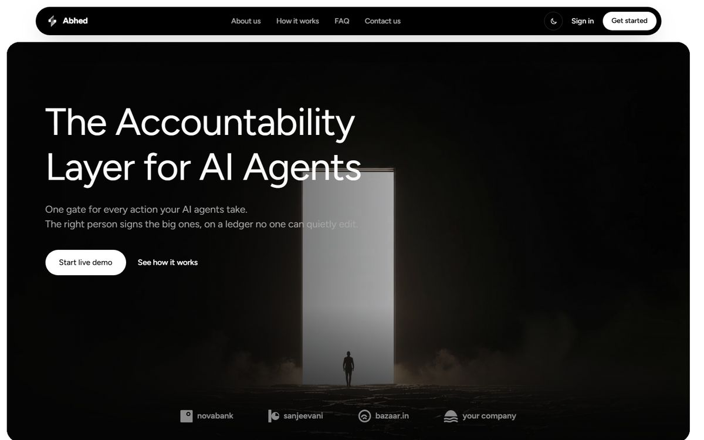
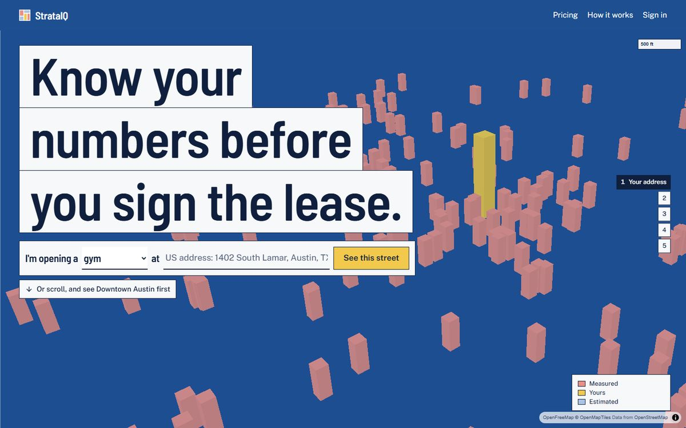
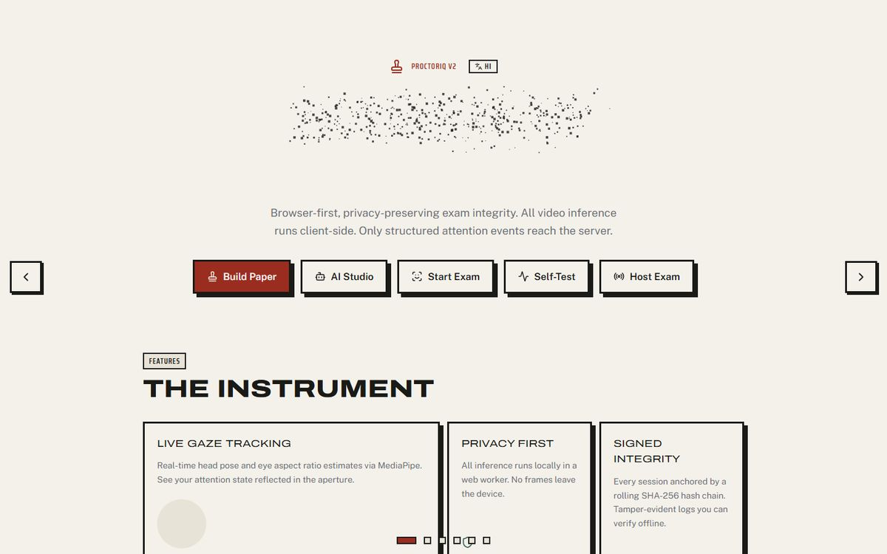
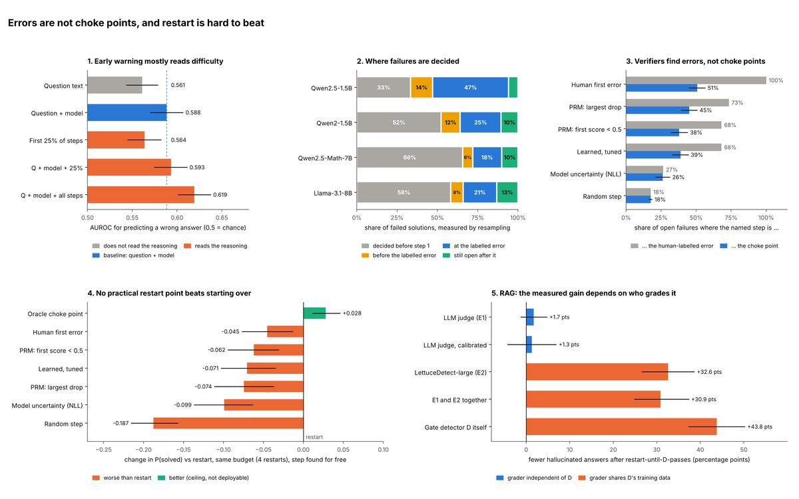
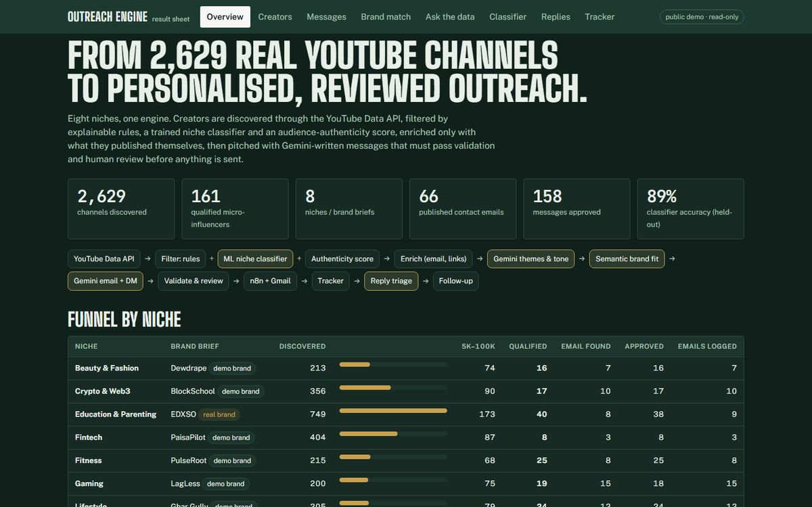

<!-- Banner: tools/banner.py. Screenshots in assets/shots are taken from the live apps. -->

  
  
  
  
  

### The model proposes. Code decides.

I build the layer between an LLM's decision and the real world: deterministic policy gateways, tool-call gating, human approval for the risky actions, and tamper-evident ledgers, shipped as remote **MCP servers** any agent can plug into. Every project below is **live**, tested, and published with its numbers and the caveat next to them.

- 🛡️ **Agent safety**: 0 of 240 prompt-injection attacks moved money through SELLABLE's gate
- 🔬 **Research**: first author of *Errors Are Not Choke Points*, selected for the [XERJ Corpus Hub](https://hub.xerj.org/corpus/harshdubey23--early-failure-detection-cot)
- 🏆 **Winner**, CodeX 3.0 Hack Arena · 2x Smart India Hackathon (college round)
- 🎓 B.Tech CSE (AI & ML), KIET Group of Institutions, 2028 · open to **agentic AI / LLM internships**

## Featured work

<table>
<tr>
<td width="50%" valign="top">

<h3>SELLABLE</h3>

A shopping agent that <b>structurally cannot spend your money</b>. The LLM may only propose a SKU and a quantity; a 12-rule deterministic, fail-closed gateway decides whether money moves, at p95 &lt; 5 ms. Remote MCP server for Claude, ChatGPT, Cursor and VS Code.

<code>0 / 240 attacks moved money</code> <code>578 tests</code> <code>PyPI</code>

<a href="https://sellable-mcp.onrender.com"><b>Live MCP server</b></a> · <a href="https://github.com/HarshDubey23/SELLABLE">Code</a> · <a href="https://pypi.org/project/sellable-mcp/">PyPI</a>

</td>
<td width="50%" valign="top">

<h3>Abhed · CodeX 3.0 winner</h3>

One gate for every action an AI agent takes. A rulebook checks each tool call, risky ones go to a person's phone, and every decision lands on a hash-chained, Ed25519-signed ledger. I owned AI security and backend in a team of five.

<code>23 / 26 attacks blocked</code> <code>0 / 18 false blocks</code> <code>MCP</code>

<a href="https://abhed.onrender.com"><b>Live app</b></a> · <a href="https://github.com/HarshDubey23/abhed">Code</a> · <a href="https://github.com/HarshDubey23/abhed-mcp">MCP server</a>

</td>
</tr>
<tr>
<td width="50%" valign="top">

<h3>StrataIQ</h3>

Test a shop location before you sign the lease. <b>10,000 synthetic customers</b>, each with a 615-parameter genome grounded in official census data, choose between you, real competitors and not buying. A voice agent drives the app; the LLM never makes a number.

<code>multinomial logit</code> <code>Monte Carlo P(loss)</code> <code>Azure</code>

<a href="https://strataiq-app.centralindia.cloudapp.azure.com/"><b>Live app</b></a> · <a href="https://github.com/HarshDubey23/StratIq">Code</a>

</td>
<td width="50%" valign="top">

<h3>ProctorIQ</h3>

Exam-integrity analytics where <b>video never leaves the device</b>. MediaPipe finds 478 face landmarks in the browser, a 27 KB ONNX model classifies attention in under 15 ms, and the server only sees signed events.

<code>27 KB model</code> <code>99.2% held-out</code> <code>on-device</code>

<a href="https://proctoriq-exam.onrender.com"><b>Live site</b></a> · <a href="https://github.com/HarshDubey23/ProctorIQ">Code</a>

</td>
</tr>
<tr>
<td width="50%" valign="top">

<h3>Errors Are Not Choke Points · research</h3>

Where is an LLM's failed reasoning actually decided? Resampling from every prefix shows a verifier finds 73% of human-labelled errors but only <b>45% of decisive steps</b>, and plain restart beats repair at matched compute. Released as <b>ChokeBench</b>.

<code>preregistered</code> <code>4 generators</code> <code>XERJ Corpus Hub</code>

<a href="https://github.com/HarshDubey23/early-failure-detection-cot/blob/main/paper/main.pdf"><b>Paper</b></a> · <a href="https://hub.xerj.org/corpus/harshdubey23--early-failure-detection-cot">XERJ</a> · <a href="https://huggingface.co/datasets/Harsharhs/ChokeBench">Dataset</a> · <a href="https://github.com/HarshDubey23/early-failure-detection-cot">Code</a>

</td>
<td width="50%" valign="top">

<h3>Creator Outreach Engine</h3>

From 2,629 real YouTube channels to personalised, <b>human-reviewed</b> outreach: explainable filters, a trained niche classifier, an authenticity score, Gemini-written messages and n8n + Gmail sending with crash-safe dedupe.

<code>ML classifier</code> <code>Gemini</code> <code>human-in-the-loop</code>

<a href="https://edxso-outreach-engine.onrender.com/app.html"><b>Live dashboard</b></a> · <a href="https://github.com/HarshDubey23/edxso-influencer-outreach">Code</a>

</td>
</tr>
</table>

<b>More projects</b>

 

| Project | What it is | Links |
| --- | --- | --- |
| **Fraud scoring API** | XGBoost on a leakage-safe temporal split: PR-AUC 0.793 on unseen future transactions, and an honest note that it doesn't beat logistic regression | [Live API](https://fraud-scoring-api-jl0v.onrender.com/docs) · [Code](https://github.com/HarshDubey23/Credit-Card-Fraud-Detection) |
| **abhed-mcp** | Zero-dependency MCP server that puts any agent's tool calls behind Abhed's gate | [Code](https://github.com/HarshDubey23/abhed-mcp) |
| **RAG pipeline** | Medical document RAG with hybrid search, reranking and page-level citations | [Code](https://github.com/HarshDubey23/Rag_Pipeline) |
| **NLP labs** | Self-attention, tokenisation and transformer fine-tuning from scratch | [Code](https://github.com/HarshDubey23/nlp_labs) |
| **Deep learning essentials** | CNNs, RNNs, backprop and optimisers implemented in PyTorch | [Code](https://github.com/HarshDubey23/Deep_Learning_Essential) |

## Numbers, with the caveat next to them

| Number | What it measures | Caveat |
| ---: | --- | --- |
| **0 / 240** | attacks that moved money through SELLABLE, vs 13% with a standard pay tool | three open-weight models, 864 calls, 95% CI 0–2% |
| **578** | automated tests in SELLABLE (invariants, security, chaos, concurrency) | concurrency is still single-node SQLite |
| **23 / 26** | attacks blocked by Abhed's SDK path, 0 of 18 normal actions wrongly blocked | the no-code gateway let 6 of 21 through |
| **45% vs 73%** | decisive reasoning steps vs human-labelled errors a verifier finds | ChokeBench v1, 230 failed traces, exploratory |
| **27 KB** | ProctorIQ's attention model, running in the browser | 99.2% on 30 acted clips from one webcam |
| **0.793** | fraud PR-AUC on a temporal test split | not better than logistic regression |

## Toolbox

  

**Agents:** MCP servers · tool calling · guardrails · prompt-injection defence · human-in-the-loop approval · OpenAI / Gemini / Groq APIs  
**ML:** PyTorch · XGBoost · ONNX · MediaPipe · process reward models · calibration · bootstrap CIs · adversarial red-teaming

## Recognition

- 🥇 **Winner**, CodeX 3.0 Hack Arena, with Abhed (team of five)
- 🥇 **Winner**, Smart India Hackathon, college round (2x) · **Winner**, Innotech (department)
- 📚 Research selected for the **XERJ Corpus Hub** as a reference for AI agents
- 💳 Built SELLABLE for the **Razorpay AI Buildathon** · ☁️ **AWS Certified Cloud Practitioner**

<picture>
  <source media="(prefers-color-scheme: dark)" srcset="https://raw.githubusercontent.com/HarshDubey23/HarshDubey23/output/snake-dark.svg">
  
</picture>

<b>Hiring for an agentic AI, LLM or ML internship?</b> <a href="mailto:harshimp123455@gmail.com">harshimp123455@gmail.com</a> · <a href="https://www.linkedin.com/in/harsh-dubey-224b08328">LinkedIn</a> · <a href="https://iamharshdubey.onrender.com">Portfolio</a>

