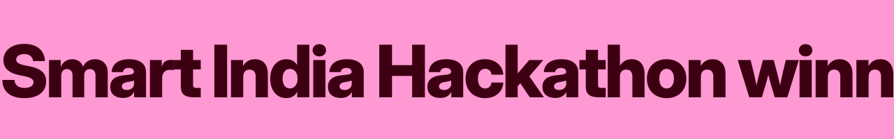

<!--
  Profile README for github.com/HarshDubey23. Same design as iamharshdubey.vercel.app.
  Every panel is an animated SVG in ./assets with the type converted to outlines.
  Edit the copy in tools/build.py and run `python tools/build.py` to regenerate them.
-->

<a href="https://github.com/HarshDubey23/SELLABLE">Code</a> &nbsp; <a href="https://github.com/HarshDubey23/SELLABLE/tree/main/docs/architecture">Architecture</a>

<a href="https://kavach-os.vercel.app">Live app</a> &nbsp; <a href="https://github.com/HarshDubey23/hackarena">Code</a> &nbsp; <a href="https://github.com/HarshDubey23/abhed-mcp">MCP server</a>

<a href="https://proctoriq-exam.vercel.app">Live site</a> &nbsp; <a href="https://github.com/HarshDubey23/ProctorIQ">Code</a>

<a href="https://github.com/HarshDubey23/Credit-Card-Fraud-Detection">Code</a>

<a href="https://github.com/HarshDubey23/early-failure-detection-cot">Code</a>

<picture>
  <source media="(prefers-color-scheme: dark)" srcset="https://raw.githubusercontent.com/HarshDubey23/HarshDubey23/output/snake-dark.svg">
  
</picture>

<a href="https://iamharshdubey.vercel.app">iamharshdubey.vercel.app</a> &nbsp; <a href="https://www.linkedin.com/in/harsh-dubey-224b08328">LinkedIn</a> &nbsp; <a href="mailto:harshdubey98190@gmail.com">Email</a>

