<!--
  Profile README for github.com/HarshDubey23
  Every visual below is a hand-built, animated SVG in ./assets (dark + light versions).
  Edit copy in tools/build.py and run `python tools/build.py` to regenerate them.
  The contribution visuals are refreshed daily by the workflows in .github/workflows.
-->

<a href="https://iamharshdubey.vercel.app">
  <picture>
    <source media="(prefers-color-scheme: dark)" srcset="./assets/hero-dark.svg">
    
  </picture>
</a>

  &nbsp;
  &nbsp;
  

> [!TIP]
> **Reviewing me for an internship?** The two-minute tour: [**ProctorIQ**](https://github.com/HarshDubey23/ProctorIQ) for on-device ML, [**Abhed**](https://github.com/HarshDubey23/hackarena) for AI-agent security, and [**Choke Points**](https://github.com/HarshDubey23/early-failure-detection-cot) for research. Every README states its limitations before its claims.

 

<picture>
  <source media="(prefers-color-scheme: dark)" srcset="./assets/sec-01-dark.svg">
  
</picture>

<a href="https://github.com/HarshDubey23/ProctorIQ">
  <picture>
    <source media="(prefers-color-scheme: dark)" srcset="./assets/card-proctoriq-dark.svg">
    
  </picture>
</a>

<a href="https://proctoriq-exam.vercel.app"><b>Live site ↗</b></a> &nbsp;·&nbsp; <a href="https://github.com/HarshDubey23/ProctorIQ"><b>Code ↗</b></a>

<a href="https://github.com/HarshDubey23/hackarena">
  <picture>
    <source media="(prefers-color-scheme: dark)" srcset="./assets/card-abhed-dark.svg">
    
  </picture>
</a>

<a href="https://kavach-os.vercel.app"><b>Live app ↗</b></a> &nbsp;·&nbsp; <a href="https://github.com/HarshDubey23/hackarena"><b>Code ↗</b></a> &nbsp;·&nbsp; <a href="https://github.com/HarshDubey23/abhed-mcp"><b>MCP server ↗</b></a>

<a href="https://github.com/HarshDubey23/SELLABLE">
  <picture>
    <source media="(prefers-color-scheme: dark)" srcset="./assets/card-sellable-dark.svg">
    
  </picture>
</a>

<a href="https://github.com/HarshDubey23/SELLABLE"><b>Code ↗</b></a> &nbsp;·&nbsp; <a href="https://github.com/HarshDubey23/SELLABLE/tree/main/docs/architecture"><b>Architecture ↗</b></a>

 

  <a href="https://github.com/HarshDubey23/early-failure-detection-cot"><picture><source media="(prefers-color-scheme: dark)" srcset="./assets/grid-chokepoints-dark.svg"></picture></a>
  <a href="https://github.com/HarshDubey23/abhed-mcp"><picture><source media="(prefers-color-scheme: dark)" srcset="./assets/grid-abhedmcp-dark.svg"></picture></a>

  <a href="https://github.com/HarshDubey23/Credit-Card-Fraud-Detection"><picture><source media="(prefers-color-scheme: dark)" srcset="./assets/grid-fraud-dark.svg"></picture></a>
  <a href="https://github.com/HarshDubey23/expensetracker"><picture><source media="(prefers-color-scheme: dark)" srcset="./assets/grid-expense-dark.svg"></picture></a>

<b>More work</b> — hackathon builds, internship and coursework

 

| Project | What it is |
| --- | --- |
| [DarshanEase](https://github.com/HarshDubey23/DarshanEase) | React + Express temple and darshan booking. Under active hardening; the README lists its security gaps. |
| [Parampara](https://github.com/HarshDubey23/winner) | Hackathon web build, live at [parampara-delta.vercel.app](https://parampara-delta.vercel.app). |
| [Restaurant](https://github.com/HarshDubey23/Resturant) | TypeScript restaurant web app, MIT licensed. |
| [DecodeLabs internship](https://github.com/HarshDubey23/DecodeLabs_internship) | Work from a one-month internship, in Python. |
| [Archived coursework](https://github.com/HarshDubey23?tab=repositories&q=&type=archived) | Earlier notebooks and MERN exercises, kept for the record. |

 

<picture>
  <source media="(prefers-color-scheme: dark)" srcset="./assets/sec-02-dark.svg">
  
</picture>

<picture>
  <source media="(prefers-color-scheme: dark)" srcset="./assets/principles-dark.svg">
  
</picture>

 

<picture>
  <source media="(prefers-color-scheme: dark)" srcset="./assets/sec-03-dark.svg">
  
</picture>

<picture>
  <source media="(prefers-color-scheme: dark)" srcset="./assets/toolkit-dark.svg">
  
</picture>

 

<picture>
  <source media="(prefers-color-scheme: dark)" srcset="./assets/sec-04-dark.svg">
  
</picture>

<picture>
  <source media="(prefers-color-scheme: dark)" srcset="./profile-3d-contrib/profile-night-green.svg">
  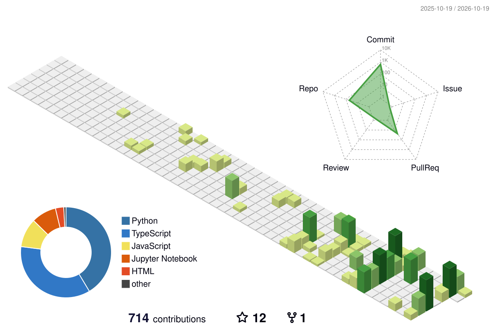
</picture>

<picture>
  <source media="(prefers-color-scheme: dark)" srcset="https://raw.githubusercontent.com/HarshDubey23/HarshDubey23/output/snake-dark.svg">
  
</picture>

  

<a href="mailto:harshdubey98190@gmail.com">
  <picture>
    <source media="(prefers-color-scheme: dark)" srcset="./assets/footer-dark.svg">
    
  </picture>
</a>

Every visual here is a hand-built SVG that follows your light or dark theme. No third-party stats servers; the activity graphics regenerate daily with GitHub Actions.

