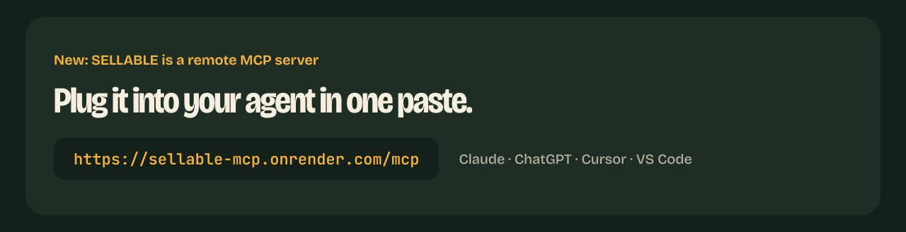

<!--
  Profile README for github.com/HarshDubey23, aligned with iamharshdubey.vercel.app.
  Every panel is an animated SVG in ./assets with the type converted to outlines (Bricolage Grotesque, OFL).
  The hero is a frame rendered from the site's own three.js world.
-->

<a href="https://github.com/HarshDubey23/SELLABLE">Code</a> &nbsp; <a href="https://github.com/HarshDubey23/SELLABLE/tree/main/mcp_server">MCP server</a> &nbsp; <a href="https://github.com/HarshDubey23/SELLABLE/releases/tag/v1.0.0">Release v1.0.0</a> &nbsp; <a href="https://github.com/HarshDubey23/SELLABLE/tree/main/docs/architecture">Architecture</a>

<a href="https://kavach-os.vercel.app">Live app</a> &nbsp; <a href="https://github.com/HarshDubey23/abhed">Code</a> &nbsp; <a href="https://github.com/HarshDubey23/abhed-mcp">MCP server</a> &nbsp; <a href="https://github.com/HarshDubey23/abhed-mcp/releases/tag/v1.0.0">Release v1.0.0</a>

<a href="https://proctoriq-exam.vercel.app">Live site</a> &nbsp; <a href="https://github.com/HarshDubey23/ProctorIQ">Code</a> &nbsp; <a href="https://github.com/HarshDubey23/ProctorIQ/releases/tag/v1.0.0">Release v1.0.0</a>

<a href="https://github.com/HarshDubey23/StratIq">

<b>StratIq</b> &mdash; Market Decision Engine & 10,000-Agent Simulation

</a>

<a href="https://strataiq-rho.vercel.app">Live Demo</a> &nbsp; <a href="https://github.com/HarshDubey23/StratIq">Code</a> &nbsp; <a href="https://github.com/HarshDubey23/StratIq#architecture">Architecture</a>

<a href="https://fraud-scoring-api.vercel.app/docs">Live API</a> &nbsp; <a href="https://github.com/HarshDubey23/Credit-Card-Fraud-Detection">Code</a>

<a href="https://github.com/HarshDubey23/early-failure-detection-cot">Code</a> &nbsp; <a href="https://github.com/HarshDubey23/early-failure-detection-cot#findings">Findings</a>

<picture>
  <source media="(prefers-color-scheme: dark)" srcset="https://raw.githubusercontent.com/HarshDubey23/HarshDubey23/output/snake-dark.svg">
  
</picture>

<a href="https://iamharshdubey.vercel.app">iamharshdubey.vercel.app</a> &nbsp; <a href="https://www.linkedin.com/in/harsh-dubey-224b08328">LinkedIn</a> &nbsp; <a href="mailto:harshimp123455@gmail.com">Email</a>

